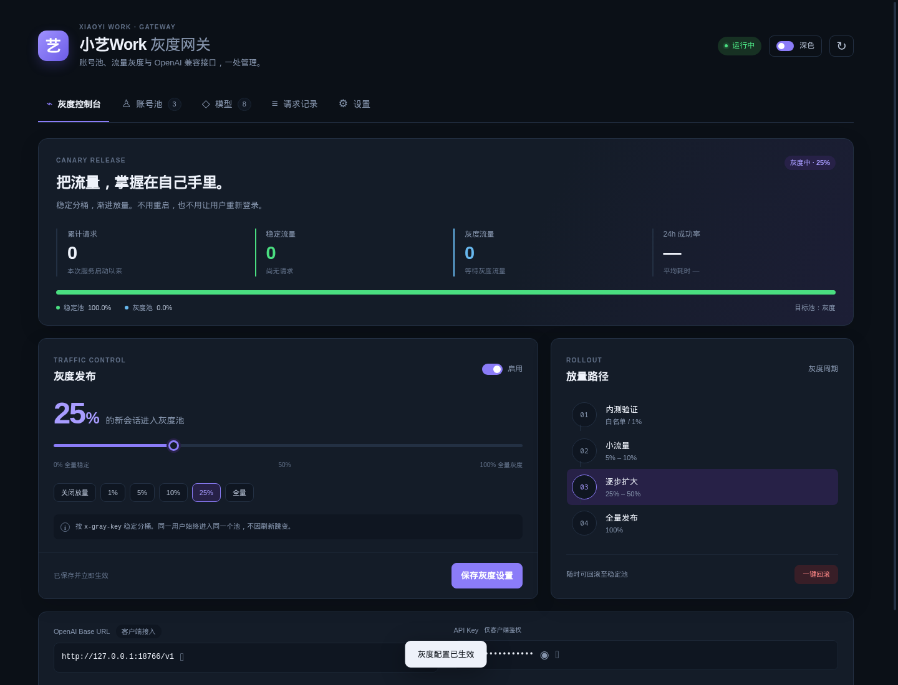

# 小艺Work 灰度网关 v2.0

独立 Node.js 服务，带**中文 Web 管理面板**，不修改上游 magpie/OpenCode 插件。
参考 [workbuddy-gateway](https://github.com/lijieyu233/workbuddy-gateway) 的卡片网格、
深/浅主题、账号池与请求记录形态重新实现；认证与转发对象仍是小艺Work，不包含
WorkBuddy 的渠道净化、签到或 WorkBuddy 账号导入逻辑。Node.js **22+**，零 npm 运行依赖。



## 一键启动

### Windows

1. 复制 `config/config.example.json` 为 `config/config.json`，填写你自己的凭据和密钥。
2. 双击 **`start.bat`**，服务启动后自动打开面板。
3. `start-lan.bat` 为局域网模式。管理接口默认仍只允许本机访问。

### Linux / macOS / 命令行

```bash
cp config/config.example.json config/config.json
# 修改 config.json 的两个访问密钥、灰度 salt、上游凭据
chmod 600 config/config.json
npm start -- --open
```

也可直接执行 `./start.sh`。其它启动参数：

```bash
node src/cli.mjs --local --open        # 默认：仅本机 127.0.0.1
node src/cli.mjs --lan --open          # 局域网 API
node src/cli.mjs --port 6000 --open    # 指定端口
node src/cli.mjs --help
```

- 面板：`http://127.0.0.1:17356`
- API：`http://127.0.0.1:17356/v1`
- 首次进入面板输入配置文件里的 `adminKey`。
- 本程序不替代当前已打开的其它 Web 应用；启动后需自行打开上面显示的面板地址。
- 自定义配置位置：`XIAOYI_PROXY_CONFIG=/绝对路径/config.json` 或 `--config 路径`。

## 面板功能

| 页面 | 已实现功能 |
|---|---|
| 灰度控制台 | 启用/停用、0–100% 滑块、1/5/10/25/100% 快捷档、一键回滚、稳定/灰度请求分布 |
| 账号池 | 稳定/灰度分栏、**华为账号 OAuth 登录**、登录态导入、删除、自动续期、积分自动查询 |
| 模型 | 模型卡片、ID 复制、倍率/视觉能力、灰度模型启停确认 |
| 请求记录 | 输出 tok/s、P50/P95、首字节/首 Token、生成耗时、时间瀑布、完整 Token 构成、本页 CSV 导出 |
| 设置 | API/Admin 密钥轮换、超时、Header/Cookie 灰度开关、客户端配置复制 |
| 通用 | 深色/浅色主题、移动端布局、管理密钥仅保存于 sessionStorage |

### 华为账号登录（不走接口授权码）

「账号池 → 添加账号」使用**华为账号 OAuth 2.0 + PKCE** 授权：

1. 面板生成 `state` + `code_verifier`，跳转华为授权页（`code_challenge_method=S256`）；
2. 回调固定为 `http://127.0.0.1:17355/auth/callback`，网关校验 `state` 后换取 token；
3. 用 access token 调用小艺 `business-credential/create` 签发凭据，按 UID 自动入池；
4. 网关默认在 17355 端口监听回调。

网关部署在 NAS/服务器时，远端浏览器打开 `127.0.0.1:17355` 会连不上，这是预期行为：
把地址栏那整条回调网址复制到面板输入框即可完成登录，`state` 仍由服务端校验。

- 同一 UID 不能同时在稳定池和灰度池：签新票会使旧票失效，两边共存会互相顶掉。
- **同一池、同一 UID 重复登录或导入会替换凭据**，保留原账号 ID，不新增重复账号；
  替换后清除旧余额缓存。相同 ID 但 UID 不同仍返回 409，防止误覆盖别人账号。
- 设备需已在小艺Work 登记；否则签票接口会拒绝，此时可改用「已有登录态导入」。
- 导入仅接受 JSON（`credential` / `uid` / `deviceId`），不接受手工粘贴 token。

白名单、黑名单、分桶 salt 等高级灰度字段仍通过 `/_admin/gray` 或配置文件维护。

从原项目 magpie 的 `plugin-auth.json` 中复制**你自己账号**的 `businessCredential`、
`uid`、`deviceId` 和 `refreshToken`。建议 stable/gray 使用独立账号：原项目指出
签新票会让同账号旧票失效，本服务不会回写小艺Work 的 Windows 注册表。

支持空账号池启动，便于先在「账号池」页录入真实凭据；在开始转发前，stable/gray
两个池都应至少添加一个账号。空池请求返回 `503 account_pool_empty`，不会发送假凭据到上游。
删除池内最后一个账号前，接口会要求明确确认。

`config/config.json` 被 `.gitignore` 排除，建议权限 `0600`。默认仅监听
`127.0.0.1`。如果改用 `--lan`，API 会监听局域网；面板接口仍按真实来源 IP 限制本机，
不采信 `X-Forwarded-For`。只有确有需要才在配置中设置 `allowPanelFromLan: true`，
并同时配置 HTTPS 与网络访问控制，不应直接暴露公网。

### Docker

镜像在 GitHub Actions 里构建，多架构（amd64 / arm64），发布到 GHCR：

```bash
docker pull ghcr.io/foglamb/xiaoyiwork-gray-gateway:latest
```

**方式 A — 拉取现成镜像（推荐）**

```bash
cp .env.example .env
# 填 XIAOYI_API_KEY / XIAOYI_ADMIN_KEY；账号可以留空，稍后在面板里用华为登录添加
echo 'XIAOYI_IMAGE=ghcr.io/foglamb/xiaoyiwork-gray-gateway:latest' >> .env
docker compose up -d
curl http://127.0.0.1:17356/healthz
```

**方式 B — 本地从源码构建**

```bash
docker compose up -d --build
```

`.env` 中的 `XIAOYI_*` 只用于**首次启动**生成 `config.json`；若 `/app/config/config.json`
已存在（bind mount 或命名卷），入口脚本会原样保留，不覆盖你的配置。

| 变量 | 说明 |
|---|---|
| `XIAOYI_API_KEY` | 客户端密钥，≥16 字符 |
| `XIAOYI_ADMIN_KEY` | 面板管理密钥，≥16 字符且不能与上面相同 |
| `XIAOYI_ACCOUNTS` | 账号 JSON 数组，留 `[]` 则在面板里用 OAuth 添加 |
| `XIAOYI_ACCOUNT_POOL` | 种子账号进哪个池，`gray`（默认）或 `stable` |
| `XIAOYI_GRAY_SALT` | 分桶盐值，留空自动生成 64 位十六进制 |
| `XIAOYI_GRAY_PERCENTAGE` | 灰度比例 0–100 |
| `XIAOYI_ALLOW_PANEL_LAN` | `0` 则面板仅容器网络内可见 |

Compose 默认只映射 `127.0.0.1:17356`；要局域网访问改成 `"17356:17356"` 并在
配置里开启 `allowPanelFromLan`。容器以非 root 运行、根文件系统只读、`cap_drop: ALL`、
`no-new-privileges`。配置目录挂载可写，用于原子保存灰度设置、续期凭据与请求元数据。

镜像标签：`latest` 与 `edge`（默认分支）、`v2.0.0` / `2.0`（git tag）、`sha-<短哈希`（可固定到某次构建）。

## Token 用量与缓存

请求记录只保存元数据，不保存对话内容：

- 输入 / 输出 / 合计 Token，来自上游 `usage`；
- 缓存命中来自 `usage.prompt_tokens_details.cached_tokens`；只有输入与缓存字段完整且
  `0 <= cached <= prompt` 的请求才计入命中率，缺失/异常数据显示未知，不按 0 填充；
- 推理 Token 来自 `usage.completion_tokens_details.reasoning_tokens`；
- 趋势图为 SVG 折线图，服务端按窗口与数据密度分桶；72h 保留完整 72 小时时间轴，不裁掉前置空窗；
- 模型总量图使用全宽竖向堆叠柱，带坐标网格、真实等比柱高、上游模型名称、图例汇总及悬停/聚焦/点击精确读数；
- 日志主表显示输出阶段平均 tok/s：`completionTokens / ((ms - ttftMs) / 1000)`；
  必须同时存在有效 TTFT、总耗时和输出用量，否则显示 `—`。端到端 tok/s 另列为
  `completionTokens / (ms / 1000)`；总体和模型分组采用一致样本，并显示有效样本数。
- P50/P95 使用 nearest-rank 分位数；小样本数量明确展示，不能视为长期性能结论。
- 新记录区分响应头时间 `responseHeadersMs`、响应体首字节 `firstByteMs` 和首个非空输出
  `ttftMs`；旧版首字节字段标为历史响应头计时。瀑布展示响应等待、首输出等待、输出阶段，
  不把网络观测推算成模型内部预填充耗时。缺失阶段保持未知。
- 请求响应头、日志使用同一个 `x-request-id`；各次尝试的上游 trace 附加 `-aN`，详情记录
  账号、HTTP 状态、动作、响应阶段耗时和错误类型，不保存提示词、凭据或上游错误正文。
- 可按时间窗口、模型、账号、成功/失败、关键字筛选并按时间、耗时、速度、Token 排序；
  列表、统计、图表都查询全部保留日志，而不是仅查询内存缓存。
- 默认每页 20 条，可选 10/20/50/100；翻页固定 `until` 历史快照，过滤和轮询保留该快照，
  包含开始早于快照但完成晚于快照的请求也不会后来插入旧页。点击「恢复最新」返回实时记录。
- 自动刷新 20 秒，可关闭，页面隐藏时停止；overview 与日志表格的查询状态相互独立。
- 本页 CSV 附带计时含义、错误类型和尝试链；对以 `= + - @` 等开头的文本防公式注入。

**不做计费估算。** 网关只报告上游接口返回的余额原值，不按 Token×倍率推算扣费：
部分模型（如本机测试的 Kimi K3.1 Pro）根本不扣积分，推算出来的数字会是虚构费用。

## 管理面板（Vue 3）

面板是 Vue 3 + `<script setup>` 单文件组件工程，构建成静态产物后由 Node 直接托管：
**构建期有依赖，运行时零依赖**，部署时不需要装前端工具链。

```bash
cd panel-ui
npm install          # 仅开发/构建需要
npm run build        # 产出 src/panel/{index.html,app.js,app.css}
```

| 项 | 说明 |
|---|---|
| 技术栈 | Vue 3.5 + Vite 7，Composition API，无 UI 框架依赖 |
| 产物 | `app.js` ≈175KB（gzip 64KB）+ `app.css` ≈59KB（gzip 11KB），单文件 |
| CSP | 仍为 `script-src 'self'`，产物无 `eval` / `new Function` / 内联脚本 |
| 页面 | 总览、灰度控制台、账号池、模型、请求记录、设置 |
| 图表 | SVG 折线图 + CSS 竖向堆叠柱图，悬停读数、6h/24h/72h 与指标切换 |
| 主题 | 深色/浅色，跟随系统偏好，选择持久化到 localStorage |
| 响应式 | ≤720px 侧栏变底部导航，实测 390px 无横向溢出 |

统计口径：`/api/logs` 的 `stats` 与图表聚合都读取**磁盘上的全部记录**
（活动文件 + 保留归档，按同一 6h/24h/72h 窗口及筛选条件过滤），内存环形缓冲是热缓存。
窗口总量不会因 `logMaxEntries` 淘汰热缓存而减少；`retainedLog` 明确标记为**保留日志累计**，
`allTimeTokens` 是兼容别名。归档过期后累计可以减少，并非永久计数器。

界面约定：管理密钥只存 `sessionStorage`；数据每 20 秒轮询一次，页面隐藏时暂停，
刷新可关闭；请求记录默认每页 20 条，可切换 10/20/50/100 并展开单条明细。
退出或换密钥会使旧会话的迟到响应失效并清空共享数据；设置与灰度草稿不会被轮询覆盖，
保存以服务端规范化结果为准，同时保留提交期间的新编辑。HTTP 局域网不支持剪贴板时会明确报错。

### 模型请求兼容与稳定性

参考 [xuediner-source/magpie-xiaoyiwork-auth](https://github.com/xuediner-source/magpie-xiaoyiwork-auth)
的实测问题报告，网关增加了以下上游适配：

- Kimi 的 `temperature !== 1` 会在转发前移除（上游默认 1），避免 `11115 / server inner`；
- Kimi 具名 `tool_choice` 验证目标唯一存在，并将 `tools` 限定为该函数后转为 `required`；
  目标不存在或重复时返回 400，防止静默调用其他工具；
- 工具 Schema 内联本地 `$ref`，并为无 `type` 的 `enum / const` 补全类型；
- SSE 错帧立即取消上游读取，流式响应仍补 `[DONE]`；非流式空错误响应转为标准 502；
- 请求体超过 **4.5 MiB** 时前置返回标准 413，避免上游挂起约 56 秒后返回 408。

Schema 归一化代码改编自上述 MIT 项目，保留引用循环、深度和展开预算保护。

### 模型目录来源

模型目录优先调用小艺 Work 的真实 HAG 接口（与 OpenCode 插件一致）：

```text
POST https://hag-drcn.op.dbankcloud.com/user-ability-gallery/v1/agent/user/query
type = CELIA_CLAW_USER_MODEL_QUERY
```

该接口直接复用当前账号的 `businessCredential + uid + deviceId`，并携带
`x-prd-pkg-name: com.huawei.hmos.vassistant`；不需要网页 Cookie。
模型 ID、名称、描述、上游灰度标志和原始倍率文本均来自响应，不写死清单。
网关自己的 `rate` 仍为 0，不根据上游倍率文本估算扣费。

若 HAG 目录不可用，才尝试网页版 `getWorkModelList` 备用会话，最后回退到：

- `observed`：保留日志中实际出现过的模型 ID；
- `config`：灰度配置里显式登记的模型 ID。

不会把回退数据伪装成上游目录。`POST /api/models/refresh` 可手动重新发现。

网页目录会话与聊天凭据分离。模型页可导入 `xiaoyi.huawei.com` 的 Cookie，
服务端保存到配置目录的 `model-catalog-session.json`，写入后强制执行 `0600`。
Cookie 不进入日志、状态接口或 Git 仓库；清除会话不会删除已验证的上游缓存。
若上游网页配置为 `enableAgent=false`，面板会直接报告功能未开放，而不是误报
Cookie 过期。任何目录故障都不影响聊天、灰度或余额接口。

### 灰度控制台

界面对应 `POST /_admin/gray`（热更新，无需重启），可调：

| 控件 | 作用 |
|---|---|
| 启用开关 | 关闭时全部流量走稳定池，不影响在途请求 |
| 比例滑块 + 快捷档 | 0 / 1 / 5 / 10 / 25 / 50 / 100%，写回 `gray.percentage` |
| 目标池 | 命中灰度的流量落到 `gray` 或 `stable` 池 |
| salt | 分桶盐值，修改后所有客户端重新分组 |
| Header / Cookie 覆盖 | 是否允许 `X-Gray-Force`、`gray_force` 强制指定 |
| 影子模式 | 只记录命中结果，不真正切换账号池 |
| 强制灰度 / 稳定名单 | 按身份强制分流，优先级高于比例 |
| 对外暴露灰度模型 | 控制 `/v1/models` 是否列出灰度模型 |
| 分流预览 | `POST /api/gray/preview` 在服务端执行相同 SHA256 分桶；需要管理员密钥，不写配置，HTTP 局域网也可用 |

灰度页显示稳定/灰度实时请求分布；所有改动先在草稿里暂存，点「保存并热更新」才提交。

### 运行调优（设置页）

`POST /api/settings` 支持热更新：`requestTimeoutMs`、`maxBodyBytes`、`allowPanelFromLan`、
`accountProbeMinutes`、`streamHeartbeatMs`、`logMaxEntries`、`grayModels`，以及模型区的
`modelCatalogMinutes`、`kimiCompatibility`、`normalizeToolSchemas`、`upstreamErrorFastFail`、
`upstreamBodyLimitBytes`。
探活/目录定时器会立即重建，0 会真正停止；心跳 0 真正关闭 keepalive；
`logMaxEntries` 立即调整内存热缓存，不裁减磁盘查询。设置草稿不被轮询覆盖，模型选择正确
映射到 `grayModels`。配置更新按队列合并最新状态，保留未变更账号的冷却、探测和轮询状态，
无关设置不会重置探活定时器。网关接收上限与上游 4.5 MiB
上限分别生效，后者超过时返回标准 413。`port` / `listen` / `upstreamUrl` 修改后需重启。

## 稳定性与可观测

| 能力 | 说明 |
|---|---|
| 日志滚动 | 活动文件按 4MB 归档，保留两个编号归档；兼容旧编号缺口及损坏行。清空同时清活动文件、归档和内存，重启不复活；写入为同步追加 |
| 流式心跳 | 上游静默超过 `streamHeartbeatMs`（默认 15s）注入 `: keepalive` 注释帧，避免中间层断连 |
| 请求观测 | 响应头、响应体首字节、首输出、总耗时、尝试链；流式错误记失败，超时 504、客户端取消 499，保留已知用量 |
| 账号探测 | `accountProbeMinutes > 0` 时定时用额度查询接口做探活，不消耗模型额度；失败自动冷却并在面板标红 |
| 手动探测 | `POST /api/accounts/probe`，面板账号卡「检测」按钮 |
| 异常兜底 | `uncaughtException` / `unhandledRejection` 记录后继续服务，连续 50 次才退出交给守护进程重启 |
| 优雅退出 | SIGTERM/SIGINT 停止接新连接，等待在途请求，3 秒后强制关闭 |

账号探测默认关闭（会真实请求上游），开启示例：

```jsonc
{
  "accountProbeMinutes": 15,   // 每 15 分钟探活一次，0 表示关闭
  "streamHeartbeatMs": 15000,  // 流式静默心跳间隔
  "logMaxEntries": 1000        // 内存热缓存上限；页面仍可查询全部保留日志
}
```

## 灰度语义

- **默认 10%**：以 `x-gray-key`（推荐传稳定用户 ID）为分桶键；没有该头才回退到
  Bearer token 的哈希。不会使用来源 IP，避免 NAT 后所有用户同时进入灰度。
- **稳定分桶**：`SHA256(salt + ":" + identity)` 前 32 bit 映射到 `[0,10000)`；
  `bucket < percentage * 100` 进入灰度。相同 salt 和身份始终同桶，调整百分比不会全局洗牌。
- **优先级**：禁用灰度 → denylist → allowlist → `x-gray-force: 0|1` →
  `x-gray-enabled: true|false` → Cookie `xiaoyi_gray=0|1` → 百分比。
- **默认禁用灰度模型**：`Kimi_K3.1_Pro_VE` 返回 403 `gray_model_disabled`；
  显式设置 `allowGrayModels: true` 后才开放，并路由至灰度池。不是单纯修改显示名称。
  模型页的“上游灰度”只描述上游元数据；“受本地灰度策略限制”才表示本网关限制，两者不再混用。
- **请求不重写模型名**：`gray.models` 是灰度模型清单，不是把请求替换成其他模型。
- **双账号池**：各池轮询；上游 401/403 且配置 refreshToken 时，自动“代刷 + 立即签票”
  并重试一次。凭据原子写回配置文件。日志只记录账号 id，不记录密钥。
- **SSE 归一化**：强制上游 `stream: true`、补 OpenAI chunk 字段、去 `id:`、补一个
  `data: [DONE]`；客户端 `stream: false` 时聚合成标准 `chat.completion`。
- **观测**：响应带 `x-xiaoyi-route`、`x-xiaoyi-pool`、`x-xiaoyi-gray-reason`、
  `x-xiaoyi-gray-bucket`、`x-xiaoyi-account`（均为内部账号标签，不含凭据）。
- `gray.shadow` 当前保留为配置字段，**未实现镜像双发**，不会影响主请求。

### 配置示例

```jsonc
{
  "apiKey": "至少16字符的客户端访问密钥",
  "adminKey": "不同的至少16字符管理密钥",
  "allowGrayModels": false,
  "gray": {
    "enabled": true,
    "percentage": 10,
    "salt": "部署时生成的固定随机串",
    "pool": "gray",
    "allowHeaderOverride": true,
    "allowCookieOverride": true,
    "allowlist": ["internal-tester"],
    "denylist": [],
    "models": ["Kimi_K3.1_Pro_VE"]
  }
}
```

## 请求

```bash
export BASE=http://127.0.0.1:17356
export KEY=你的_apiKey

curl -N "$BASE/v1/chat/completions" \
  -H "Authorization: Bearer $KEY" \
  -H 'Content-Type: application/json' \
  -H 'x-gray-key: user-10001' \
  -H 'x-gray-force: 1' \
  -d '{"model":"LLM_DeepSeekV4_Think","stream":true,"messages":[{"role":"user","content":"只回复：可用"}]}'
```

```bash
# 非流式（上游仍是 SSE，由反代聚合）
curl "$BASE/v1/chat/completions" \
  -H "Authorization: Bearer $KEY" -H 'Content-Type: application/json' \
  -H 'x-gray-key: user-10001' \
  -d '{"model":"LLM_DeepSeekV4_Think","stream":false,"messages":[{"role":"user","content":"你好"}]}'

# 查看模型、状态与灰度命中
curl "$BASE/v1/models" -H "Authorization: Bearer $KEY"
curl "$BASE/_admin/stats" -H 'x-admin-key: 你的_adminKey'

# 热更新灰度至 25%，先原子持久化再切换运行配置
curl -X POST "$BASE/_admin/gray" \
  -H 'x-admin-key: 你的_adminKey' -H 'Content-Type: application/json' \
  -d '{"percentage":25,"allowlist":["internal-tester"]}'
```

OpenAI SDK：

```python
from openai import OpenAI
client = OpenAI(api_key="你的_apiKey", base_url="http://127.0.0.1:17356/v1")
answer = client.chat.completions.create(
    model="LLM_DeepSeekV4_Think",
    messages=[{"role": "user", "content": "你好"}],
    extra_headers={"x-gray-key": "user-10001"},
)
print(answer.choices[0].message.content)
```

## 上线步骤

1. `allowGrayModels=false`、`gray.percentage=0` 启动；用 `x-gray-force: 0/1` 分别验证两池。
2. 确认返回 Header、SSE `[DONE]`、非流式聚合与工具调用。
3. 内测名单写入 `allowlist`，保留 `denylist` 作为紧急退出名单。
4. 逐步调百分比 `1 → 5 → 10 → 25 → 50 → 100`，每档查看 `/_admin/stats` 与上游错误。
5. 回滚时 `percentage=0`，或 `enabled=false`；必要时将指定 `x-gray-key` 加入 `denylist`。
6. 若要开放 Kimi 灰度模型，编辑配置把 `allowGrayModels` 改为 `true` 后重启，
   或通过 `POST /_admin/gray` 传 `{"allowGrayModels":true}` 热更新；
   小流量验证成功前不建议开放，原项目标注其消耗倍率为 `13x`。

## 接口

| 方法 | 路径 | 鉴权 | 用途 |
|---|---|---|---|
| GET | `/` | 本机 + Admin key | Web 管理面板 |
| GET | `/healthz` | 无 | 存活检查，不含账号信息 |
| GET | `/v1/models` | API key | 模型清单，默认不含灰度模型 |
| POST | `/v1/chat/completions` | API key | 流式/非流式聊天反代 |
| GET | `/api/state` | 本机 + Admin key | 面板聚合状态 |
| GET/POST | `/api/keys` | 本机 + Admin key | 查看/轮换访问密钥 |
| POST/DELETE | `/api/accounts`、`/api/accounts/:id` | 本机 + Admin key | 添加/删除账号 |
| POST | `/api/accounts/:id/quota` | 本机 + Admin key | 查询积分与权益包 |
| POST | `/_admin/gray` | Admin key | 灰度热更新（比例/名单/覆盖/影子） |
| POST | `/api/settings` | 本机 + Admin key | 热更新超时、体积上限、探活、心跳、日志上限、灰度模型 |
| POST | `/api/models/refresh` | 本机 + Admin key | 重新获取上游模型目录，失败保留真实回退来源 |
| POST | `/api/models/session` | 本机 + Admin key | 导入网页目录 Cookie 并立即验证，响应不含 Cookie |
| DELETE | `/api/models/session` | 本机 + Admin key | 清除网页目录 Cookie，保留真实上游缓存 |
| GET | `/api/logs` | 本机 + Admin key | 分页请求日志 + 统计 + 图表聚合 |
| POST | `/api/logs/clear` | 本机 + Admin key | 清空请求记录 |
| POST | `/api/auth/oauth/start` | 本机 + Admin key | 发起华为账号 OAuth 登录 |
| GET | `/api/auth/oauth/status` | 本机 + Admin key | 轮询登录状态并在成功后入池 |
| POST | `/api/auth/oauth/complete` | 本机 + Admin key | 用复制的回调网址完成登录 |
| POST | `/api/auth/oauth/cancel` | 本机 + Admin key | 取消登录流程 |
| POST | `/api/auth/import` | 本机 + Admin key | 导入已有登录态 JSON |
| POST | `/api/quota/refresh` | 本机 + Admin key | 刷新全部账号余额 |
| GET | `/_admin/config` | Admin key | 脱敏运行配置和统计 |
| GET | `/_admin/stats` | Admin key | 按池、原因、账号计数 |
| POST | `/_admin/gray` | Admin key | 原子热更新灰度配置 |

## 原项目分析与复用边界

分析版本：`23991d04e95da075cabf9363184d4c42dd37cd92`（2026-11-23 读取）。

原项目是 **magpie/OpenCode 供应商插件**，自身不是独立 HTTP 反代。其关键链路：

1. `makeFetch` 强制 `/celia/v1/sse-api/chat/completions` 使用 SSE；删除客户端 Bearer，
   注入 `businessCredential + x-uid + x-device-id`。
2. 上游只发 SSE、没有 `[DONE]`；`transformSse` 补 OpenAI 字段与结束标记，
   `aggregate` 负责非流式。
3. 凭据续期必须先 `/user-credential/v1/xiaoyiwork/refresh-token`，随后立刻
   `/business-credential/create`；中间 accessToken 不能缓存。
4. 模型目录依赖 `x-prd-pkg-name: com.huawei.hmos.vassistant`。
5. 原项目的 `showGray` 是“是否显示官方标灰模型”，不是“流量灰度发布”；本服务
   将两者拆开：模型灰度默认拒绝，流量灰度按稳定分桶选择账号池。

原项目声明 MIT，详见 `UPSTREAM_NOTICE.md` 与其
[仓库](https://github.com/llf223/opencode-xiaoyiwork-auth)。本反代只复用协议行为，
没有复制插件登录、Windows DPAPI、本机注册表和 magpie UI 逻辑；也不处理签票后回写
Windows 注册表，故建议使用独立的灰度账号。

## 验证范围

`npm test` 使用本机临时 HTTP 服务器和合成 SSE，不消耗真实账号点数；
`node --test panel-ui/test/*.test.mjs` 验证前端状态与纯逻辑，两套测试均进入 GitHub CI：
稳定分桶、灰度边界、Header/Cookie 优先级、灰度模型拒绝、鉴权、SSE 分包、
`[DONE]`、工具调用聚合、池路由、配置脱敏/热更新、401 续期重试、面板静态资源、
账号增删、积分查询、密钥保护、日志元数据与远端面板来源限制；
另覆盖 OAuth PKCE 参数、state 不匹配/过期、回调地址校验、同 UID 重登替换与跨池重复拒绝、
日志分页上限与环形缓冲、缓存/推理字段落库、空缓冲不截断日志文件；
另覆盖 HAG 模型目录、Kimi 参数与工具 Schema 归一化、4.5 MiB 413 保护、
SSE 错帧早断和非流式 502 错误透传；另验证设置热更新、日志缓存调整和心跳 0。
新增回归覆盖多次轮转/重启/清空、旧分片与快照查询、P95 与速度样本一致、
请求 ID/重试链、响应头与首字节区分、缓存有效样本、超时和主动取消、并发设置合并、
分页跨轮询/乱序保护、草稿保护/保存字段、CSV 注入防护及柱图真实比例；
目录刷新覆盖账号切换、凭据续期、成功/尝试时间、空目录回退、Cookie 清理与并发导入串行化。

另使用本机 Chromium 150 对合成账号实例做过浏览器验收：登录、25% 灰度热更新、
账号/模型卡片、添加账号弹窗、深浅主题、移动端 390px 布局均通过，浏览器无 JS 异常。
截图在 `artifacts/`。这些是合成界面数据，不代表真实小艺额度或模型调用结果。

本次另用自有账号实测：Kimi 在 `temperature: 0` 下返回 200；包含 `$ref` 和无类型
`enum` 的具名工具调用返回 200，且正确生成 `echo({"text":"ok"})` 工具调用。
其它账号、积分与模型仍建议使用自己的账号做上线前验证。

## 参考项目

- 小艺认证协议：[opencode-xiaoyiwork-auth](https://github.com/llf223/opencode-xiaoyiwork-auth)，MIT。
- 面板与启动方式参考：[workbuddy-gateway](https://github.com/lijieyu233/workbuddy-gateway)，分析版本 `f5d26d5d424fa7565403ff3e959822e008ddce30`。
- 本面板为独立重写，不依赖参考项目运行，不加载其外部脚本、字体、图片或接口。
